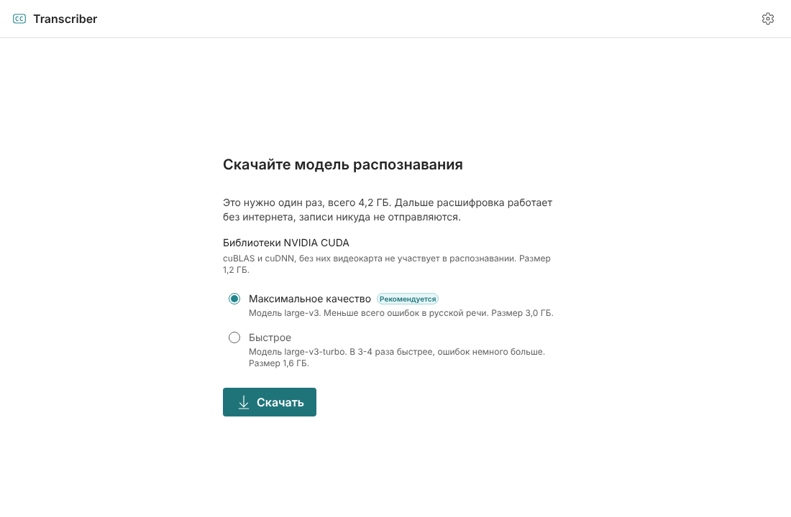
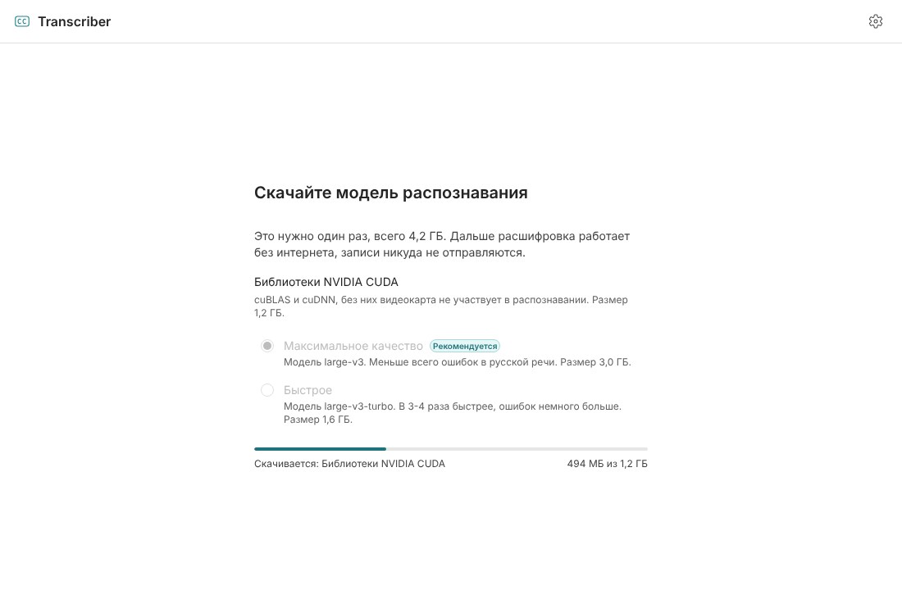
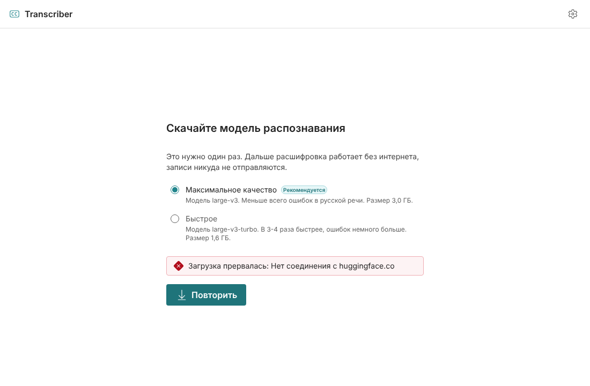
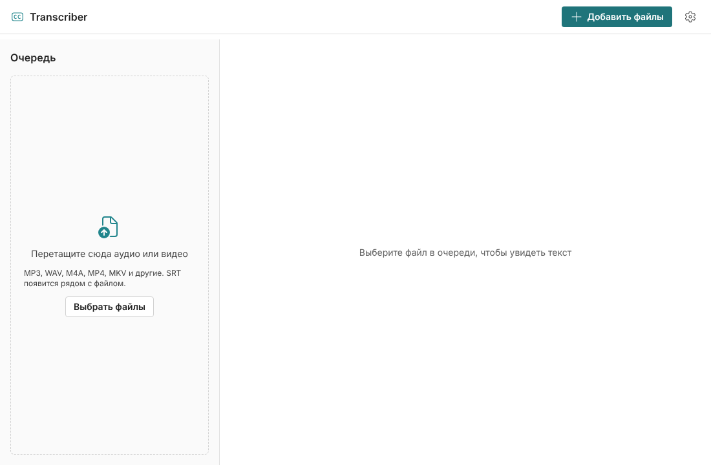
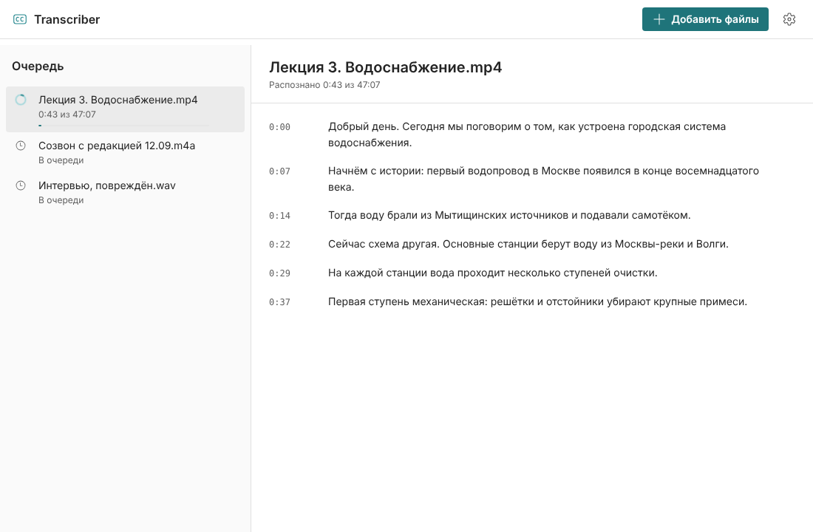
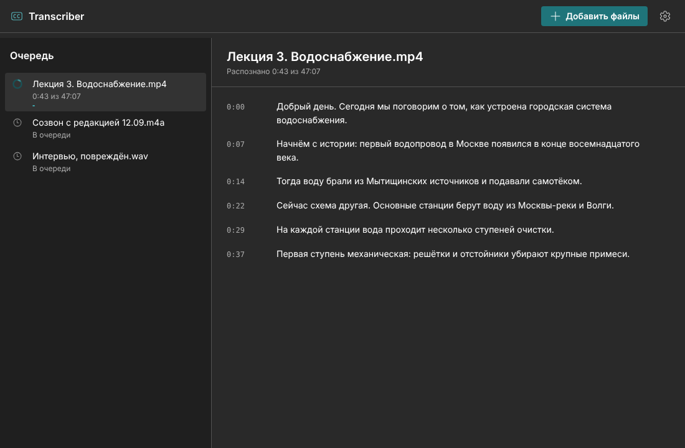
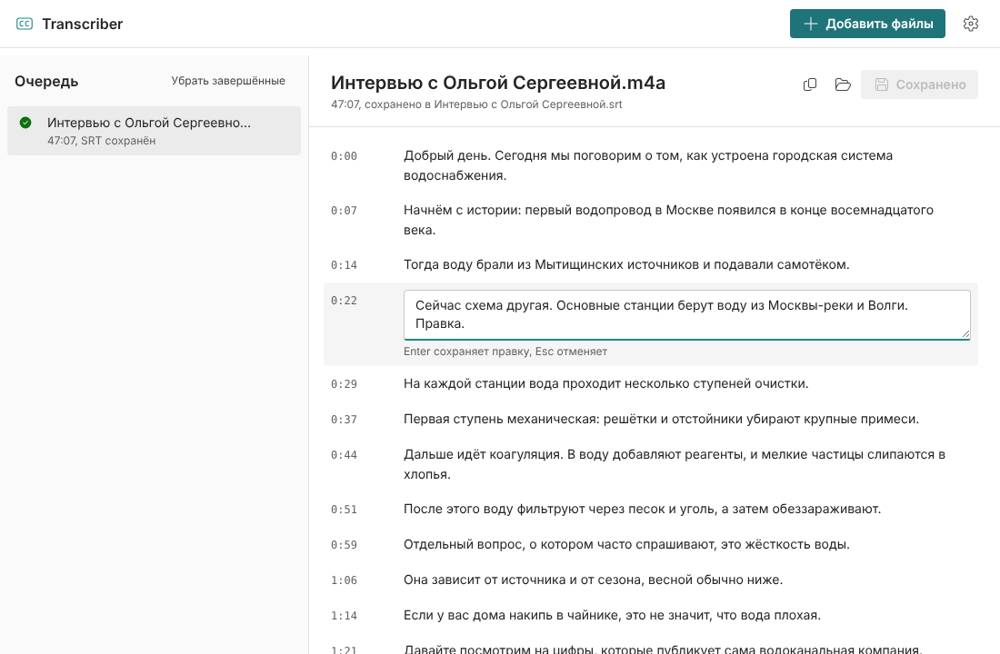
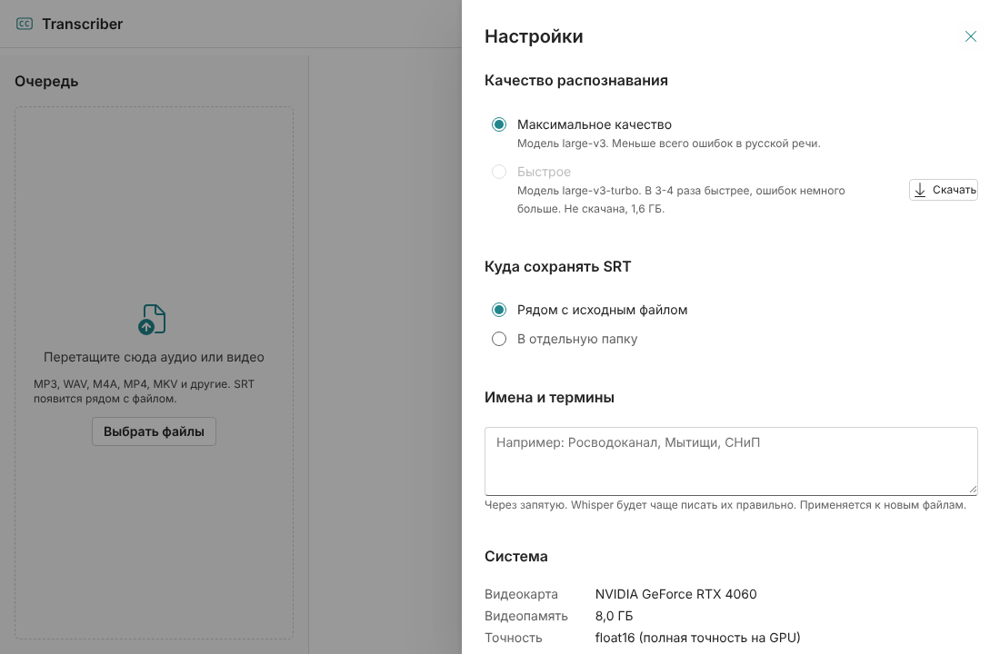
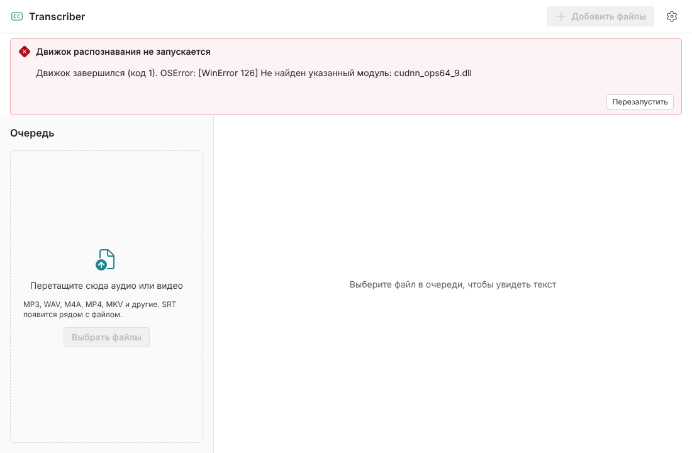

# Дизайн интерфейса (этап 4)

Сделан по правилам [taste-skill](https://github.com/Leonxlnx/taste-skill): основной навык
`design-taste-frontend` плюс `minimalist-ui`.

## Design read

Десктопная утилита для Windows: один человек превращает русские записи в SRT.
Язык спокойный и нативный для Windows. Основа: **Fluent UI React v9** с собственным
брендовым цветом.

Почему Fluent, а не самописные стили. Taste-skill предназначен для лендингов, а для
продуктовых интерфейсов прямо требует брать официальную дизайн-систему
(раздел 13 «Out of scope», таблица 2.A: Microsoft-продукты → `@fluentui/react-components`).
Для приложения под Windows это ещё и привычный пользователю вид: те же кнопки, списки и
панели, что в Windows 11.

Ручки навыка (1-10): вариативность раскладки 3, анимация 3, плотность 5.

## Система

| Что | Решение |
|---|---|
| Компоненты | Fluent UI v9, одна система на весь проект |
| Акцент | Один: бирюзовый (hue 184). Палитра из 16 шагов в `app/src/theme.ts` |
| Контраст | Белый на кнопке 5,47:1 в светлой теме (по умолчанию у Fluent было бы 4,38:1, ниже AA), акцентный текст в тёмной теме 4,93:1 |
| Тема | Светлая и тёмная, по настройке Windows (`prefers-color-scheme`) |
| Шрифты | Segoe UI (системный шрифт Windows, его использует Fluent), таймкоды: Cascadia Mono |
| Скругления | Токены Fluent (4 / 8 px), без смешения систем |
| Иконки | Только `@fluentui/react-icons` |
| Анимация | Только стандартные переходы Fluent; при `prefers-reduced-motion` отключаются |
| Тексты | Без длинных тире, без «ИИ-клише», короткие функциональные формулировки |

## Экраны

**Первый запуск.** Приложение скачивает библиотеки NVIDIA CUDA (если есть видеокарта) и
одну из двух моделей, рекомендует подходящую для видеокарты. Всё одной кнопкой, по очереди.



Скачивание с прогрессом в мегабайтах (сначала CUDA, потом модель) и ошибка с повтором:




**Пустая очередь.** Область для перетаскивания файлов прямо в списке.



**Распознавание.** Слева очередь со статусами и прогрессом, справа текст появляется
по мере распознавания и прокручивается сам, пока пользователь не начал читать выше.




**Правка.** Щелчок по фрагменту открывает редактор. Enter сохраняет правку, Esc отменяет.
После правок активируется кнопка «Сохранить SRT». Копирование текста и «Показать в
папке» вынесены в иконки с подсказками.



**Настройки** (боковая панель): качество, куда сохранять SRT (рядом с файлом или в папку),
имена и термины для подсказки Whisper, сведения о видеокарте.



**Движок не запустился.** Причина из stderr движка и кнопка перезапуска.



## Как посмотреть без Tauri

```bash
cd app && npm run dev
```

В браузере открывается интерфейс с имитацией движка (`src/engine/mock.ts`, в сборку
приложения не попадает). Сценарии: `?scenario=first-run` (CUDA и модель не скачаны), `download-error`, `working`,
`empty`, `failed`, `cpu`.
